

# Clubs Club

### Ce que vous jouez, écoutez, regardez et lisez — partagé avec les vôtres.

Une seule bibliothèque pour vos jeux, votre musique, vos films, vos séries et vos livres. 
Et des clubs pour les découvrir, en parler et les noter entre amis.

 

**Gratuit** · **Sans publicité** · **En français** · Sur ordinateur, iPhone et Android

 

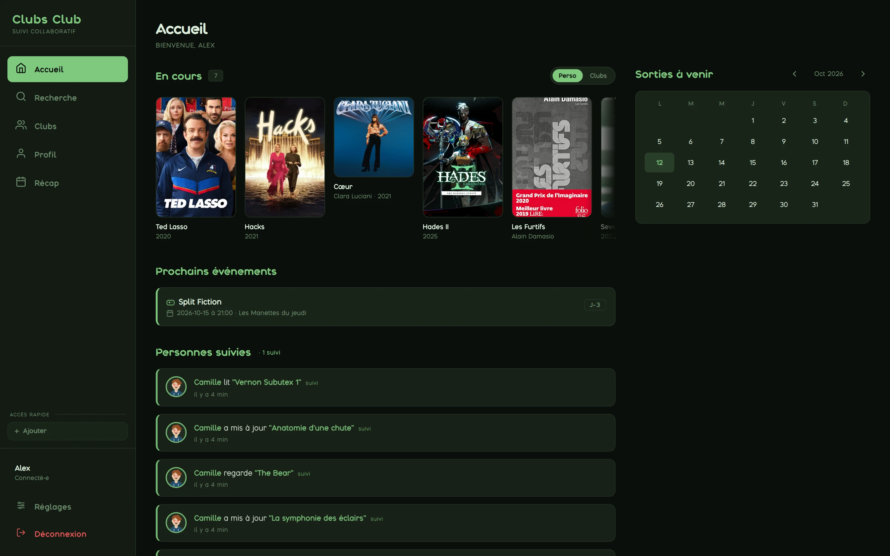

 

## Tout ce que vous aimez, enfin au même endroit

Les jeux dans une appli, les films dans une autre, les livres dans un carnet, la musique nulle part. On finit par oublier ce qu'on a aimé, et surtout par ne plus le partager.

Clubs Club réunit tout. Chaque œuvre a sa fiche, son statut, votre note et votre critique. Et parce qu'un bon film se discute, vos amis ne sont jamais loin.

 

<table>
  <tr>
    <td width="50%" valign="top">
      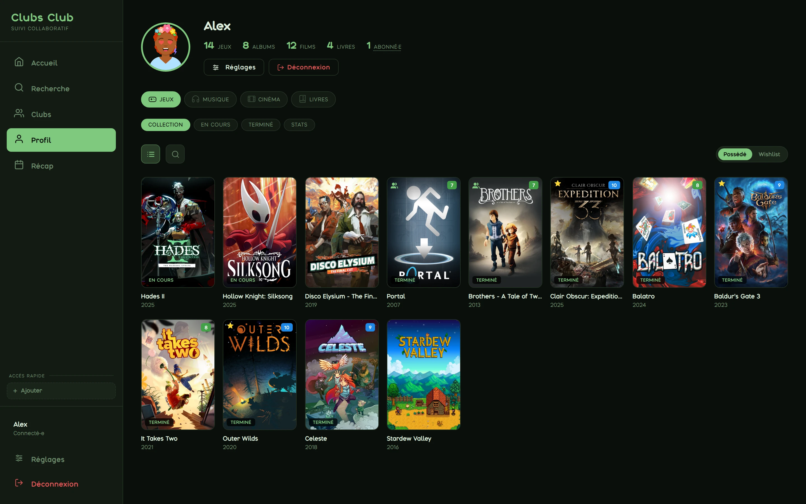
      <h3>Une bibliothèque, quatre univers</h3>
      Jeux vidéo, musique, cinéma et séries, livres : la même logique partout. Ce que vous voulez découvrir, ce qui est en cours, ce que vous avez terminé — d'un coup d'œil, avec vos notes sur chaque jaquette.
    </td>
    <td width="50%" valign="top">
      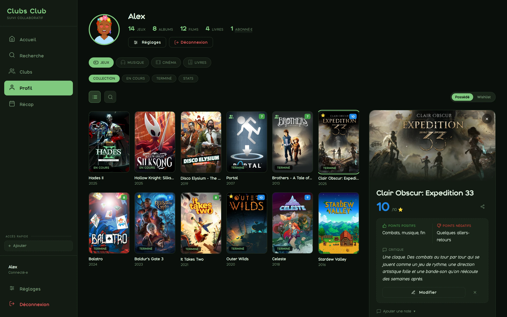
      <h3>Vos critiques, à votre façon</h3>
      Une note sur 10, les points forts, les points faibles, quelques lignes si le cœur vous en dit. Un coup de cœur d'un geste. Et une critique prête à être envoyée à quelqu'un.
    </td>
  </tr>
  <tr>
    <td valign="top">
      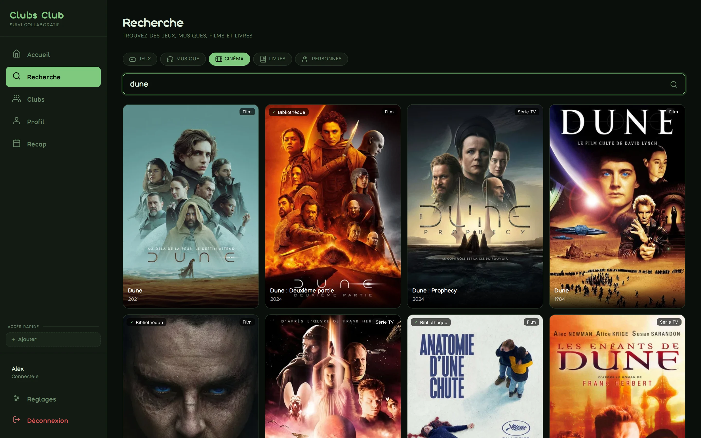
      <h3>Tout se trouve en une recherche</h3>
      Un jeu, un album, un film, une série, un livre, ou un ami : une seule barre. Synopsis, casting, éditions françaises des livres, et ce que vous possédez déjà est signalé.
    </td>
    <td valign="top">
      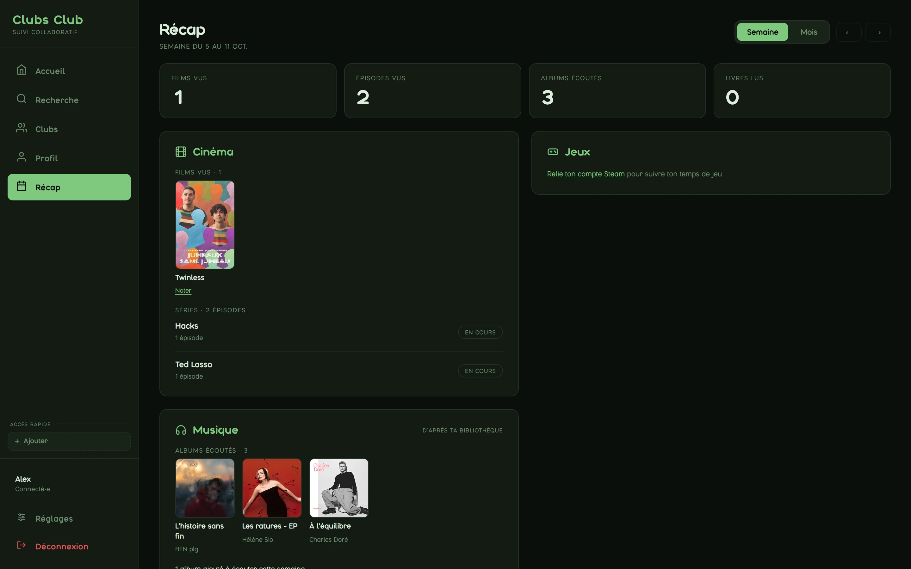
      <h3>Votre récap</h3>
      Chaque semaine et chaque mois, ce que vous avez vu, écouté, lu et joué. Et en fin d'année, votre bilan complet à parcourir comme une histoire.
    </td>
  </tr>
</table>

 

## Des clubs, pour partager vraiment

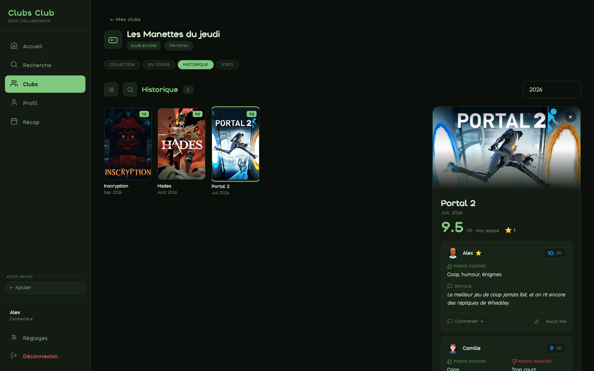

 

Un club de lecture, un ciné-club, une bande qui enchaîne les jeux en coop : créez le vôtre et invitez vos amis.

- **Proposez et votez.** Chacun suggère une œuvre, les envies des autres font le tri.
- **Lancez et retrouvez-vous.** L'œuvre du moment, avec la date et l'heure de la réunion. Un rappel arrive la veille.
- **Notez ensemble.** Chacun donne sa note et sa critique ; le club garde la moyenne de l'équipe, les désaccords et les coups de cœur.
- **Gardez la mémoire.** L'historique du club, année après année : le meilleur, le pire, le mois le plus actif, le membre le plus sévère.

<table>
  <tr>
    <td width="50%">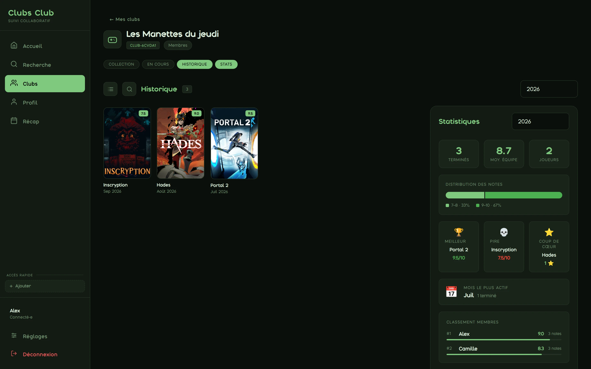</td>
    <td width="50%">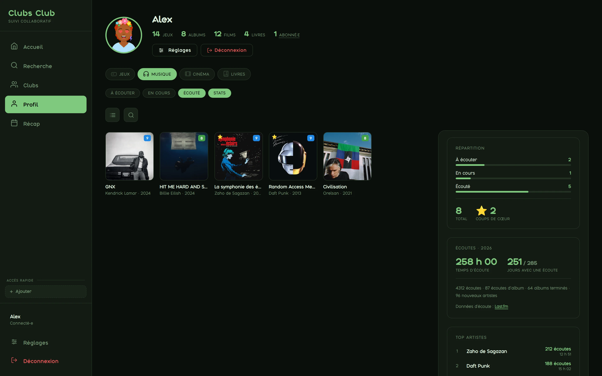</td>
  </tr>
  <tr>
    <td align="center"><b>Les statistiques du club</b> — qui note le plus haut, quelle œuvre a mis tout le monde d'accord.</td>
    <td align="center"><b>Votre année en musique</b> — temps d'écoute, artistes, albums et titres les plus écoutés.</td>
  </tr>
</table>

 

## Votre bibliothèque se remplit toute seule

Reliez vos comptes une fois, Clubs Club s'occupe du reste. Vous gardez toujours la main : rien n'est marqué « terminé » à votre place.

| | |
|---|---|
| **Steam** | Vos jeux, votre temps de jeu, vos sessions et votre progression. Vos amis voient à quoi vous jouez en ce moment, si vous le souhaitez. |
| **Last.fm** | Ce que vous écoutez sur Deezer, Spotify ou Apple Music. Un album écouté d'affilée entre dans votre bibliothèque, et vos statistiques d'écoute se construisent au fil de l'année. |
| **Jellyfin** | Les films et les épisodes que vous regardez chez vous sont cochés automatiquement. |
| **Letterboxd et Goodreads** | Importez d'un coup vos films vus et vos livres lus. |

 

## Dans votre poche

  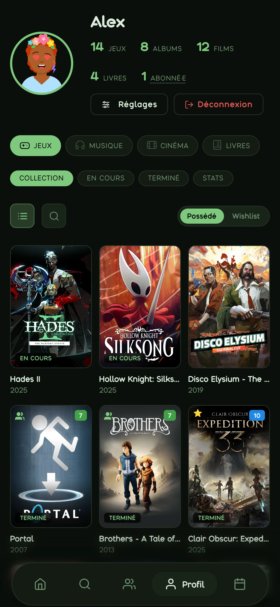
  &nbsp;
  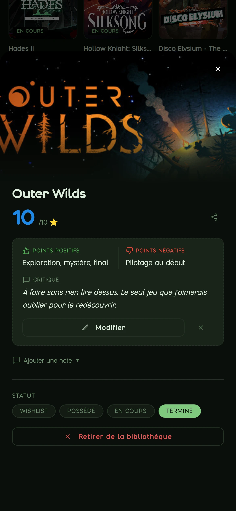
  &nbsp;
  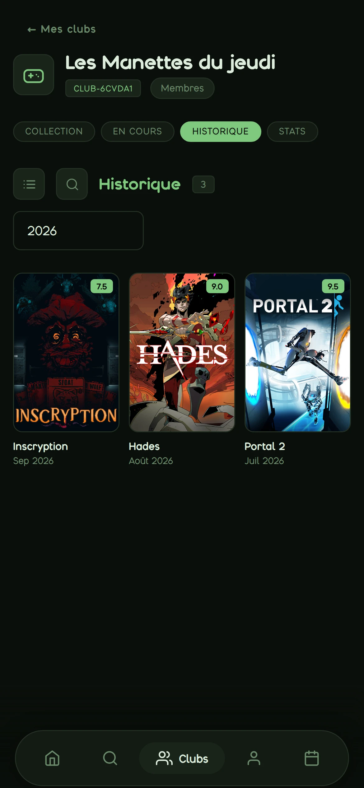
  &nbsp;
  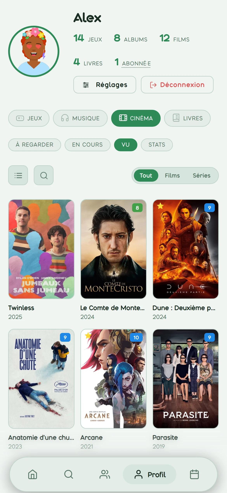

Clubs Club s'installe sur l'écran d'accueil de votre téléphone comme n'importe quelle application, sans passer par un magasin d'applications.

- **Des notifications utiles**, et seulement celles que vous choisissez : un ami a commenté votre critique, la réunion du club approche, un jeu que vous attendiez sort aujourd'hui.
- **Le calendrier des sorties** de tout ce que vous suivez.
- **Dix thèmes**, cinq sombres et cinq clairs, qui suivent le réglage de votre appareil si vous le voulez.

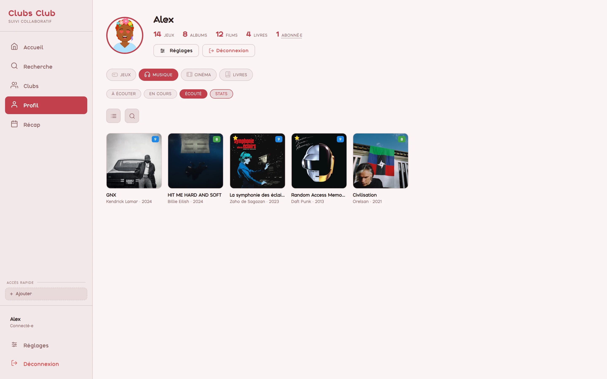

 

## Pensé pour un cercle d'amis

- **Pas de publicité, pas de traqueur.** Vos données ne sont ni vendues ni partagées à des fins publicitaires.
- **Un pseudo suffit.** Pas d'adresse e-mail obligatoire pour créer un compte.
- **Pas de course à l'audience.** Pas de fil algorithmique, pas de compteur à faire grimper : vous suivez des amis, pas des inconnus.
- **Vous décidez de ce qui se voit.** Votre activité de jeu et d'écoute se partage, ou non, d'un simple interrupteur.

 

## Commencer en une minute

1. Ouvrez **[clubs-club.web.app](https://clubs-club.web.app)** et choisissez un pseudo.
2. Ajoutez ce que vous jouez, écoutez, regardez et lisez en ce moment.
3. Créez un club, ou rejoignez celui de vos amis avec son identifiant.

Sur téléphone, ajoutez ensuite le site à votre écran d'accueil pour l'utiliser comme une application.

 

## Informations

| | |
|---|---|
| **Prix** | Gratuit |
| **Langue** | Français |
| **Compatibilité** | Navigateur sur ordinateur · iPhone et iPad · Android |
| **Compte** | Un pseudo et un mot de passe |
| **Catégorie** | Divertissement · Réseaux sociaux |

 

 

---

Les écrans présentés proviennent de comptes de démonstration : aucune donnée d'un membre réel n'y figure. 
Les jaquettes, affiches et pochettes appartiennent à leurs ayants droit et ne servent qu'à identifier les œuvres. Les informations sur les œuvres proviennent de Steam, IGDB, TMDB, Apple Music, Last.fm, Hardcover, Google Books et Open Library. Ce produit utilise l'API de TMDB, sans être approuvé ni certifié par TMDB. 
© Clubs Club. Tous droits réservés.

